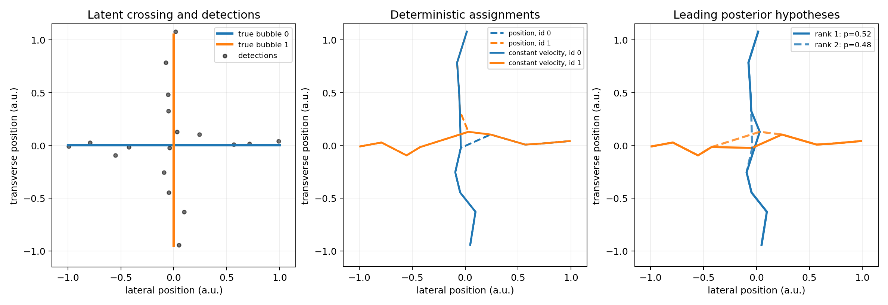

# SB–ULM tracking

**Physics-informed posterior sampling for uncertain microbubble trajectories.**

Research prototypes for ultrasound localization microscopy (ULM): when noisy
detections cross, disappear, or compete with clutter, which trajectories remain
plausible, and how much confidence should each receive?

> [!WARNING]
> **Research software under active development.**
> Interfaces and experimental protocols may change. Results currently concern
> controlled synthetic benchmarks; crowded-scene scalability and in-vivo
> validation remain open. This is not a validated clinical tracking system.

## Main findings

| Finding | Evidence and scope |
|---|---|
| **Modeling localization uncertainty avoids severe overconfidence.** | On **3,136 paired synthetic cases**, reference-path inclusion at 95% nominal credible mass rises from **35.52% to 99.01%** with an explicit Gaussian observation likelihood. The latter is conservative on this frozen simulator, rather than universal calibration. [Benchmark and limits](docs/wp2_localization_likelihood.md). |
| **A posterior-sampling baseline is validated on small problems.** | Collapsed annealed sequential Monte Carlo (SMC) passes **9/9 primary runs**. Across a **196-case** fixed-cardinality map, total variation, Jensen–Shannon divergence, and finite-sample-calibrated credible-set recall pass in every case; each covers **>98.80%** of exact posterior mass. [Protocol and results](docs/smc_matern_calibration.md). |
| **Crowded tracking remains the research frontier.** | Birth/death, missed-detection, and clutter extensions have small exact-target checks, but reliable sampling on crowded four-slot/eight-frame cases is unresolved. Three numerical full-joint reference targets now support a frozen **24-run** control/candidate comparison; a completed gate decision is not yet recorded. [Reference targets](docs/wp11ap_positive_joint_cohort.md) · [Comparison protocol](docs/wp11aq_bound_cohort_comparison.md). |

The repository name reflects its Schrödinger-bridge research direction. The
validated SMC baseline is a Bayesian sampler; it is not itself a learned
diffusion model. Bridge-based experiments are documented separately.



*Illustrative synthetic crossing, in arbitrary units: a single assignment hides
alternatives that the posterior can retain with explicit probability weights.
See the [controlled-crossing results](docs/initial_results.md).*

## Approach

- **Physical priors:** Gaussian-process trajectory models, including a
  velocity-calibrated Matérn prior in physical ULM units.
- **Unordered observations:** a Gaussian localization likelihood with a tested,
  differentiable set potential; extensions for missed detections and clutter.
- **Posterior inference:** exact enumeration for small reference problems,
  annealed SMC, and reversible association/existence moves.
- **Reproducible evaluation:** Hungarian tracking baselines, exact-target
  comparisons, uncertainty diagnostics, frozen protocols, and recorded failures.

## Quick start

Python **3.10+**. The core demo runs on CPU with NumPy, SciPy, and Matplotlib.

```bash
git clone https://github.com/hacheleroy/SB-ULM-tracking.git
cd SB-ULM-tracking
python -m venv .venv
source .venv/bin/activate
python -m pip install -e ".[dev]"
python -m sbulm.experiment --output-dir results/demo
```

This writes a crossing figure and a JSON summary for 32 synthetic seeds.
The demo uses an exactly enumerable association posterior; it does not train
a neural network or reproduce the full SMC calibration study.

Run the core checks:

```bash
python -m pytest tests/test_simulation.py tests/test_inference.py \
  tests/test_calibration.py tests/test_localization.py tests/test_smc.py
```

The optional `tsbm` extra is only needed for the separate TSBM integration.

## Explore the code and research

| Entry point | Purpose |
|---|---|
| [`src/sbulm/`](src/sbulm/) | Simulation, physical priors, likelihoods, inference, and diagnostics |
| [`tests/`](tests/) | Numerical identities, invariant moves, and small exact-target checks |
| [`results/`](results/) | Recorded synthetic benchmark summaries and figures |
| [Scientific roadmap](docs/roadmap.md) | Work packages, decision gates, and unresolved questions |

Selected reading:

- [SMC calibration](docs/smc_matern_calibration.md) and
  [birth/death model](docs/wp4_birth_death_slots.md).
- [Generalization boundary](docs/wp8_generalization.md) and
  [current crowded-case protocol](docs/wp11aq_bound_cohort_comparison.md).
- [Smooth-SB integration](docs/smooth_sb_integration.md) and
  [TSBM comparison](docs/tsbm_wp2_integration.md), including negative results.
- [Earlier research log](docs/research_log.md), preserved from the previous
  README; later developments are documented in the work-package notes.

## Data and licence

The benchmark outputs are synthetic. Third-party datasets and implementations
are referenced externally; their licences and usage conditions are listed in
[resources and provenance](docs/resources.md).

Original repository code is available under the [MIT licence](LICENSE).
Third-party resources retain their own licences.
